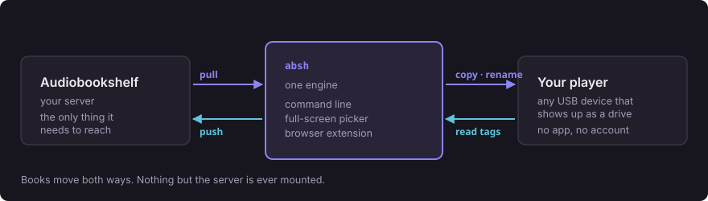
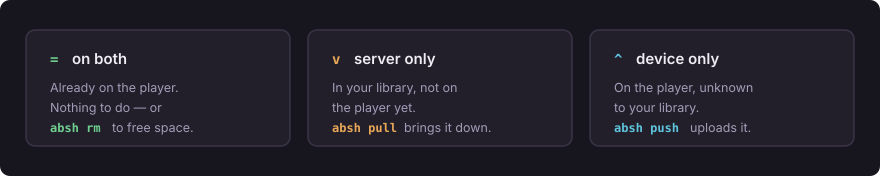

# Audiobookshelf Helper

Copy books between [Audiobookshelf](https://audiobookshelf.org) and any USB
player that shows up as a drive — and copy side-loaded books back the other way.

<p align="center"></p>

No app on the device, no account, no SMB or NFS mount. Everything goes through
the Audiobookshelf API: if you can open your server in a browser, `absh` can
use it.

## `absh` is the whole tool

A Python program with a command line and a full-screen picker. It needs no
browser at all.

```bash
absh status          # what is where
absh pull redwall    # server -> device
absh push --all      # device -> server
absh tui             # pick interactively
```

The browser extension is a front-end for exactly that engine — the same code,
not a second implementation. It puts badges on the book cards in Audiobookshelf
itself and adds buttons to copy, upload or delete without leaving the page.

Firefox and Chrome. The Python side runs on macOS, Linux and Windows.
Audiobookshelf **v2.26.0 or newer** — the release that added API keys, which is
how this connects. Settings says so if your server is older. See
[Which Audiobookshelf](#which-audiobookshelf).

## Every book is in one of three states

<p align="center"></p>

That third state is the interesting one. A book that is only on the device —
ripped, side-loaded, inherited from an older player — is identified from the
tags inside the file, and can be uploaded into your library.

## Install

### Just the command line

Nothing to install. Python 3.9+ and the repository is enough:

```bash
git clone https://github.com/dadatuputi/audiobookshelf-helper.git
cd audiobookshelf-helper

python3 -m absh.cli devices     # what is plugged in, and where
python3 -m absh.cli config --url http://media.local:13378 --key <api key> \
                           --device PLAYER
python3 -m absh.cli doctor      # checks every moving part
python3 -m absh.cli status
```

`--device` takes a full path *or* just the volume name, so `--device PLAYER`
works without anyone remembering whether this OS mounts it under `/Volumes`,
`/media/you` or `/run/media/you`.

`pip install mutagen` is optional and improves tag reading on unusual files;
everything works without it. On Windows, `absh tui` additionally needs
`pip install windows-curses` — Python does not ship curses there. Every other
command works without it.

### Plus the extension

From the [latest release](https://github.com/dadatuputi/audiobookshelf-helper/releases)
you need two files:

- `audiobookshelf-helper-app-<version>.zip` — **the helper app, for your
  computer**. Unzip it, run `python3 install.py` in that folder, restart the
  browser. It copies itself to a folder of its own — `~/Library/Application
  Support/Audiobookshelf Helper` on a Mac, `~/.local/share/audiobookshelf-helper`
  on Linux, `%LOCALAPPDATA%\Audiobookshelf Helper` on Windows — so the
  download can be deleted afterwards. Updates go there too.
- `audiobookshelf-helper-firefox-extension-<version>.xpi` (open it in Firefox),
  or `audiobookshelf-helper-chrome-extension-<version>.zip` (unzip it, then
  Load unpacked).

Or [build it yourself](#building-locally), and register the helper so the
browser knows where to find it:

```bash
python3 native/install.py
```

Then load the extension:

- **Firefox** — `about:debugging#/runtime/this-firefox` → Load Temporary Add-on
  → `extension/dist/firefox/manifest.json`. Temporary add-ons unload on
  restart; a signed `.xpi` from the releases page installs permanently.
- **Chrome** — `chrome://extensions` → Developer mode → Load unpacked →
  `extension/dist/chrome`

`install.py` takes `--dry-run` and `--uninstall` (which removes the installed
copy too). A checkout is registered where it is, so what you edit is what
runs. The browser is pointed at a generated launcher — a `.bat` on Windows,
which cannot execute a `.py` directly, and a shell script elsewhere — that
names the Python you installed with, falls back to `/usr/bin/python3` if that
one goes, and says on stderr (Firefox's Browser Console) if the helper's files
are missing.

### Sandboxed browsers on Linux

A browser installed as a Snap or a Flatpak cannot start a program outside its
sandbox by itself, and the helper is one. `install.py` says which of these it
finds.

- **Firefox as a Snap** (Ubuntu's default) works. It asks Ubuntu's desktop
  portal to start the helper. The portal reads the manifest `install.py` writes
  to `~/.mozilla/native-messaging-hosts` and starts the helper outside the
  sandbox, where it can reach your player. The first time the extension
  connects, Ubuntu asks whether to allow it: choose **Allow**. If you chose
  *Don't allow*, run the command `install.py` printed (a `gdbus call …
  SetPermission webextensions … snap.firefox "['yes']"`), then restart
  Firefox. The portal needs Ubuntu 22.04 or later; `install.py` says if yours
  lacks it. A weekly CI job installs the Snap and checks this end to end.
- **Firefox as a Flatpak** works only where the same portal exists, which on
  most distributions it does not yet — and even there, Flathub's Firefox does
  not use it until told to. Where the portal exists (Ubuntu), open
  `about:config`, set `widget.use-xdg-desktop-portal.native-messaging` to `1`,
  restart Firefox, and choose **Allow** when asked; this opens nothing else in
  Firefox's sandbox. `install.py` says so, with the Flatpak's own "undo Don't
  allow" command. Without the portal, Settings will say the helper is not
  installed. The weekly job checks all three: as installed, with the setting,
  and with no portal. Use Firefox from your distribution or from Mozilla instead.
  There is a workaround — give the Flatpak permission to run programs on the
  host (`flatpak override --user --talk-name=org.freedesktop.Flatpak
  org.mozilla.firefox`) and point a manifest at a `flatpak-spawn --host`
  wrapper — but that lets anything in Firefox run anything on your computer,
  which is the protection a Flatpak exists to give. This project does not set
  it up for you.
- **Chromium or Chrome as a Snap or Flatpak** cannot start the helper. Use
  [Chrome without the helper](#chrome-without-the-helper): it writes to the
  player's folder itself.

### Chrome, without the helper

If you can't install the helper, or would rather not, Chrome can write to the
player itself: Settings → **Folder** (under *Optional*) → **Choose the
player's folder…**, and pick the player's top folder (the one `AUDIOBOOKS` is
in). Grant access to your server too, because Chrome then makes the requests to
it itself. Pull, upload, delete and the three-way status all work, with the
same folder names, file names and matching as the helper - the two are held to
one set of test vectors (see [Tests](#tests)).

What you give up:

- **Finding the player.** You pick its folder in a dialog; nothing lists what is
  plugged in. If it mounts somewhere else next time, pick it again.
- **Plug and unplug events.** Chrome isn't told. The library page checks again
  when you come back to it, and the popup each time it opens.
- **Lasting access.** Chrome keeps the extension's access only while one of its
  tabs is open (the options page counts; the toolbar popup does not), and asks
  again after it restarts. The popup and the library page say so and send you
  to Options, where one click restores it. If Chrome offers *Allow on every
  visit* when you do, choosing it makes access last.
- **Free space**, which Chrome doesn't report for a folder.
- **Some tags.** Books only on the player are recognised from MP3 and
  M4A/M4B tags or their names - what the helper does without `mutagen`.
- **The command line and the TUI**, which are the helper.

The helper always wins when it is installed and answering, unless you tick
*Use this folder even when the helper is installed*. Firefox has no folder
picker and Mozilla does not plan one, so there the helper is the only way.

### Updating the helper

In the extension: Options → **Helper** shows which version is installed and
whether a newer release is out, and installs it with **Update** — no terminal,
and no browser restart, because the old helper exits once it has replaced
itself and the next request starts the new one. The popup shows one line when
an update is waiting. The helper asks GitHub at most once a day on its own (or
when you press **Check for updates**); the extension itself has no access to
GitHub, and nothing is installed without the click. When this copy cannot
update itself — a git checkout, a folder you cannot write to, or a build that
pins no signing key — the page says which, in the helper's own words, and shows
no button.

Or from the folder you unzipped a release into:

```bash
python3 -m absh.cli update --check   # what is available, and whether it is signed
python3 -m absh.cli update           # install it, then restart the browser
python3 -m absh.cli update --tag v1.0.0-alpha.4   # go back to a specific release
```

Both choose the release the same way. A copy of a prerelease is offered the
next prerelease; a copy of a stable release only stable ones. Neither will touch
a git checkout — update that with git.

Either way, it installs only a release whose `SHA256SUMS` is signed by a key your
installed copy already trusts (`absh/release_keys.py`), whose signed manifest
names the release you asked for, and whose archive matches that manifest. The
key is held by the maintainer, offline — not by GitHub — so being able to
publish a release is not enough to get code onto your machine this way. It
will not quietly downgrade you either: an older release is installed only when
named with `--tag` on the command line, and only if it too is signed; the
Update button only ever goes forward. After swapping the files it
starts the new helper and has it list a test device; if that fails, the
previous version is put back.

There is no switch to skip the signature check. Releases from before signing
began (`v1.0.0-alpha.3` and earlier) are not signed, so `absh update` refuses
them; to install one, download its helper app zip and run `python3 install.py`,
which is the same trust decision as your first install.

## Configure

Toolbar icon → the **Library** card, or `absh config`, or <kbd>s</kbd> in the TUI. All three write
the same file.

| Setting | Notes |
|---|---|
| Audiobookshelf URL | e.g. `http://media.local:13378` |
| **Grant access** | Extension only. Required — [see below](#the-permission-grant) |
| API key | Audiobookshelf → Settings → API Keys (v2.26.0 or newer) |
| Device path | Absolute, e.g. `/Volumes/PLAYER` or `E:\`. In the extension it is set from the toolbar popup's **Player** strip, not Options — it changes more often than anything else here. **Detect** lists what is plugged in, and the popup opens the strip by itself when the saved player isn't connected |
| Folder on device | `AUDIOBOOKS` by default, set beside the player in the popup. Some players give a named folder resume and bookmarks — check your manual |
| Folder template | `{author}` `{title}` `{series}` `{narrator}`. Also how a book is recognised on the device, so changing it makes synced books look absent. Two editions of one book (a full-cast recording and a single narrator) never share a name: the second gets its narrator added, or a number. Names are cut to 80 characters, at a word, so that no path on the player passes the 260 that Rockbox and Windows can open. A cut keeps an ending like "(Full Cast)", and a long list of authors gives way to the first |
| Rename m4b → m4a | Leave on unless your player handles `.m4b` |

### The permission grant

The extension ships with **no host permissions and no content script**. On a
fresh install it can reach no site at all — check `chrome://extensions`, site
access is empty.

Because Audiobookshelf is self-hosted, its address isn't knowable at build time.
So *Grant access* computes the single origin pattern for the URL you typed
(`http://media.local:13378/*`) and requests only that. The toolbar button is
then registered at runtime for every page on that origin. Audiobookshelf is a
single-page app: you open the server and it routes to the library or a book
without loading a page, so a script matched against `/library/*` would never run
for most people.

This is why the manifest lists `*://*/*` under `optional_host_permissions` and
never requests it as written.

## Use

### From the command line

```bash
absh devices             # find the device
absh status              # the three-way picture
absh ls                  # what is on the device
absh pull redwall holes  # match on title, author or series
absh pull --all
absh push --all          # upload everything the server does not have
absh rm redwall          # asks first; -y to skip
absh tui                 # full-screen picker
absh doctor              # why isn't it working
```

Every command takes `--dry-run`. `pull` copies what the device does not have,
and updates what it copied before when Audiobookshelf has changed it since. It
goes file by file and writes only what differs: a file the server has not
touched is not downloaded at all, and a file that did change is compared in
blocks against the copy, so only the changed sectors are written. `absh pull
--all` is cheap to re-run. `--force` goes over every matching book, for when
you do not trust what is there, and still writes only what differs.

#### Tags

Audiobookshelf keeps a book's details (title, author, series, narrator) in its
database, and writes them into the files only when you run its **Embed
Metadata** tool. A pull can run that tool for you, through the server's API,
before it copies a book, so the copy on the player carries the same title,
author, series, narrator, cover and chapters, and the player's own library
shows books the way Audiobookshelf does.

Know what that means before you say yes:

- **It changes the files in your library**, not just the copies. It is the same
  thing the button on the book's page does.
- **Your API key must belong to an admin.** It is the key you already set; in
  Settings → API Keys, the user a key acts as decides this. With a regular
  user's key the book is copied as it is, and the pull says why.
- **A book's files are fetched again after an embed**, because the server has
  rewritten them. Only the sectors that differ are written to the player, but
  the download is the whole book. A book is embedded again only when its
  details change.
- **Chrome's folder mode** copies the files as they are; embedding needs the
  helper.

`pull` asks the first time (`[y]es, [n]o, [a]lways, ne[v]er`; always and never
are saved). `--tags` and `--no-tags` answer for one run, and `absh config
--write-tags ask|always|never` sets it. With nobody at the keyboard it does not
embed. The TUI asks the same way, and <kbd>w</kbd> in its settings changes it.

In the TUI: <kbd>space</kbd> selects, <kbd>/</kbd> filters, <kbd>p</kbd> pulls,
<kbd>u</kbd> pushes, <kbd>d</kbd> deletes, <kbd>r</kbd> refreshes,
<kbd>s</kbd> opens settings, <kbd>q</kbd> quits. Settings is also where you pick
the device from a list of what is mounted, so the TUI is usable before anything
is configured beyond the server.

### In Audiobookshelf

Every cover gets a strip along its foot: **✓ On <player>**, **Copying…** with a
bar, **Waiting to copy**, or **Copy to player**, where the whole strip is the
button. A book's own page gets **Copy to <player>** under Play, or **Remove
from <player>** when it is already there, with a line saying how it stands;
Remove asks once more, in place, before it deletes anything. A series,
author, collection or playlist page gets one button beside the page's own,
**Copy series to <player> · 4 books, 2.1GB**, which copies everything that
page lists that the player lacks - asking once more, in place, when that is
more than ten books, and saying so instead when they would not fit. The
button in Audiobookshelf's toolbar says which player is connected and how much
of the library is on it ("SANSA · 3 of 28 on it"), and opens the book picker.
Copies started here run in the extension's background, so the popup shows them
too. Books on the device but *not* in your library appear in a panel with an
**Upload** button.

### In the popup

Your library on the left, your player on the right, and three directions
between them: **To player**, **Both**, **To library**, each with its count. Tick
and press the button, which names what it will do and where ("Copy 2 to
AGPTEK A02", with the size against the free space). Each row's second line is
narrator and length, which is what tells two versions of a book apart; the
chevron opens the rest. While a filter is on, each tab counts "7 of 345".
A copy belongs to the extension, not the popup: close it and reopen it and the
copy is still there, row by row, with the overall progress under the shelf.
Books queued one after another - cover after cover - count as one run.
Unplug the player mid-run and it pauses ("Paused · SANSA disconnected"),
leaving no half-written book behind; plug it back in and it carries on, with
a book cut off partway picking up from its next file. Quitting the browser
mid-run loses nothing either: the queue is kept and resumes next time. A
paused run can be let go with **Cancel the rest**.

**Copying books again.** On **Both**, tick the box at the top to select every
book on the player, then **Copy again** (<kbd>C</kbd>). A book's own page has a
**Copy again** button beside Remove. Each book is checked against
Audiobookshelf file by file and only the 4 KB pieces that differ are written,
so a copy that is already right costs a download and no writes. With tags on,
a book whose details were never embedded, or have changed, is embedded first.
In Chrome's folder mode a file that differs is written whole. From the command
line it is `absh pull --all --force`.

While copying, the toolbar icon carries a count, then a check when it is done,
and a notification says so if the popup is closed.
Click the **Player** card to change player: the one that looks most like yours
is offered in purple, and nothing is saved until you press **Use**. Every action
has a key, printed on it: <kbd>/</kbd> filter, <kbd>⏎</kbd> the main button,
<kbd>R</kbd> re-read, <kbd>C</kbd> copy again, <kbd>D</kbd> detect, <kbd>Esc</kbd> cancel. Light or dark
follows your system. A line under the status says when a helper
update is waiting — see [Updating the helper](#updating-the-helper).

## Finding the device

There is no reliable, dependency-free way to ask an OS "which of these is a USB
audio player", so nothing here pretends to. Instead it lists the removable
volumes that *are* mounted and ranks them by how player-like they look — a
volume that already has your books folder wins outright, one this tool has
synced to before is next, and a small volume beats a large one. You pick.

```
  VOLUME                     SIZE     FREE  PATH
* PLAYER                    7.4GB    2.1GB  /Volumes/PLAYER  AUDIOBOOKS/ (12 items)
  Time Machine              2.0TB    412GB  /Volumes/Time Machine
```

All three front-ends offer it: `absh devices`, <kbd>s</kbd> in the TUI, and the
**Detect** button in the extension's toolbar popup, under **Player**.

If your player mounts somewhere the desktop conventions do not cover — by hand
under `~/mnt`, or from an idiosyncratic fstab entry — set `ABSH_DEVICE_ROOTS`
to the mount point (several separated like `PATH`) and that replaces the search
entirely.

On macOS the boot volume is deliberately skipped: it appears under `/Volumes` as
a symlink to `/`, and offering it as a "device" would point `remove` at your
whole filesystem.

## How books are matched

The hard part of two-way sync is deciding that a folder on a USB stick *is* a
given library item. Three steps, in order:

1. **The sidecar index.** Whenever this tool puts a book on a device it records
   the item id in `<device>/.absh/index.json`. Exact and instant.
2. **The expected name.** A folder matching what the template would have
   produced.
3. **Embedded tags.** Title and author read from the file itself, normalised so
   "The Hobbit"/"J.R.R. Tolkien" and "Hobbit, The"/"JRR Tolkien" agree.

A book is only reported as *device only* — and offered for upload — once all
three have failed to find it on the server. That is what stops a hand-copied
file with a scruffy name being uploaded when your library already has it.

Deleting the index is harmless; matching just falls back to tags.

## Building locally

**From a fresh clone, in the repo root, this is the whole thing:**

```bash
python3 extension/build.py     # -> extension/dist/firefox, extension/dist/chrome
python3 native/install.py      # register the helper, then restart the browser
```

No `npm install`, no bundler — the extension builds with **Python alone**. Node
is only for the tests and linters.

> **Where did it go?** `extension/dist/`, not `dist/`. It is gitignored, so it
> will not appear in `ls` at the repo root. The build prints the full path and
> the load instructions when it finishes.

`--target firefox` or `--target chrome` builds just one. Re-run after any change
under `extension/src/` and press reload in the browser; there is no watch mode
because the build is a file copy plus a generated manifest and takes about a
tenth of a second.

### The release artefacts, byte-for-byte

`tools/package.py` is the same script the release workflow runs:

```bash
python3 tools/package.py                       # stamped v0.0.0, into release/
python3 tools/package.py --tag v1.0.0-alpha.1  # exactly what that tag ships
```

Four archives plus a `release-info.json`: a Firefox bundle (`manifest.json` at
the root, as AMO wants), a Chrome bundle, a native bundle (`absh_host.py`,
`install.py`, `identity.json` — unzip and run `python3 install.py`), and a
source archive for AMO's source-code review.

### npm scripts, if you prefer them

```bash
npm install                    # only needed for tests and linters
npm run build                  # python3 extension/build.py
npm run package                # python3 tools/package.py  (add -- --tag vX.Y.Z)
npm run icons                  # regenerate the PNG set
npm test                       # python + unit + e2e
npm run test:py                # no node needed
npm run lint:ext               # web-ext lint, the check AMO runs
```

## Design notes

<details>
<summary><b>Why there is a native helper</b></summary>

A browser extension **cannot** write to a USB device. Two hard limits, both
verified — the architecture collapses without them, so don't "simplify" them
away:

1. **`downloads.download({filename})`** — per MDN: *"Absolute paths, empty
   paths, path components that start and/or end with a dot (.), and paths
   containing back-references (`../`) will cause an error."* Everything lands
   under the browser's Downloads folder.
2. **`showDirectoryPicker()`** — the File System Access API that would grant
   write access to a chosen folder — is not implemented in Firefox, and
   Mozilla's position is that it should not be.

So the extension is a UI and the Python engine does the work. The engine is the
part that can destroy data, so it carries the heavier tests. With the helper,
the extension never talks to Audiobookshelf directly — it asks the helper,
which uses the same client the command line does, so the two can never disagree
about what is on your device.

Chrome does have the picker, so the Chrome build carries a second backend,
`extension/src/folder.js`, for people who won't install the helper. It is a
port of naming, matching, tag reading and sync, not a new design, and it cannot
quietly drift: `tools/parity_vectors.py` records what the Python does with a few
hundred inputs, the Python tests fail if the recording goes stale, and the
JavaScript tests - in node and in a real Chromium filesystem - fail if the port
disagrees with it. Where it runs was measured, not assumed (Chromium 141): the
service worker can read and write through a handle the options page stored in
IndexedDB but cannot show a picker or ask for permission; Chrome withdraws an
extension's folder grant within a second or two of its last tab closing (the
popup and an offscreen document do not count), and after a restart, unless the
user chose *Allow on every visit*. So the folder is chosen and re-allowed on the
options page, and the worker does the copying.
</details>

<details>
<summary><b>Why the m4b → m4a rename works</b></summary>

An `.m4b` *is* an MP4/AAC container. Players that reject `.m4b` are refusing the
extension, not the codec — their decoder handles the AAC-LC inside perfectly
well. Renaming is lossless and instant: no transcoding, no quality change.

The trade-off is chapters. One long `.m4a` gives no chapter navigation on a
simple player; keep a book as multiple files if you want to skip around.
</details>

<details>
<summary><b>Why the API key never goes in a URL</b></summary>

Audiobookshelf accepts a key as `?token=` as well as a Bearer header, and an
early version of this built such URLs for downloads. A key in a URL ends up in
server logs, proxy logs and browser history, so every request — downloads
included — sends it only in the `Authorization` header. `store/PRIVACY.md`
says so, and a test holds the code to it.
</details>

<details>
<summary><b>How the extension knows which card is which book</b></summary>

From the API responses Audiobookshelf itself fetched, captured by a small
page-world script. The DOM never carries the id — cards render as
`#book-card-{index}` and the id lives in Vue component state, so scraping it
would break on any upstream release. If the mapping is unavailable the page is
left alone rather than showing badges that might be wrong.
</details>

<details>
<summary><b>Other things worth knowing</b></summary>

- Multi-file books copy as `001 - …`, `002 - …` so they sort correctly; disc
  subfolders are flattened in order.
- Names are transliterated to ASCII and stripped of `<>:"/\|?*`.
- Some older players (SanDisk Clip+ and Clip Zip among them) need
  **Settings → USB Mode → MSC** before they mount as a drive at all.
- Firefox and Chrome disagree on exactly two manifest keys, so `build.py` emits
  both rather than shipping a lowest-common-denominator manifest: background is
  `{"scripts": [...]}` vs `{"service_worker": ..., "type": "module"}`, and the
  add-on id is `browser_specific_settings.gecko.id` vs one derived from `key`.
- `lib.js` is a classic script with a CommonJS tail: it has to load three ways
  without a bundler — Firefox's MV3 `background.scripts`, Chrome's module
  service worker, and node for tests.
- `playwright-webextext` is gone. It crashes on any MV3 add-on with no
  `content_scripts`, because `overridePermissions()` short-circuits into
  `manifest.optional_permissions.length` when that key is absent. Firefox
  manifest validation is covered by `web-ext lint` — Mozilla's own
  addons-linter, the same check AMO runs on submission.
</details>

<details>
<summary><b>Layout</b></summary>

```
absh/             THE ENGINE - stdlib only, so the browser can always launch it
  abs_api.py      Audiobookshelf client: libraries, items, download, upload
  device.py       scans the device; produces the three-way diff
  devices.py      finds mounted volumes and ranks them
  tags.py         embedded metadata; mutagen if present, MP4/ID3 parsers if not
  index.py        the sidecar .absh/index.json written on the device
  naming.py       on-device naming, shared by every operation
  sync.py         pull, push, remove
  config.py       defaults < file < environment < arguments
  cli.py          absh status/ls/pull/push/rm/doctor/config/devices/tui
  tui.py          curses picker
  host.py         the native-messaging protocol
  update.py       absh update: verify the signature, swap, self-check, roll back
  releases.py     which release is latest, by semver, prereleases included
  signing.py      the signed-release format; ed25519.py verifies it, stdlib only
  release_keys.py the signing keys an installed copy trusts
extension/
  identity.json   the add-on id, host name and Chrome key - one source of truth
  icons/          make_icons.py generates the PNG set with no dependencies
  src/            manifest.base.json, background, page-hook, content, popup, options
                  folder.js, folder-options.js: Chrome only - the player as a chosen
                  folder, without the helper
  build.py        emits dist/firefox and dist/chrome
native/
  absh_host.py    thin shim: finds the absh package and runs absh.host
  install.py      registers the helper (6 OS x browser combinations)
tools/            package.py, sign_release.py, release_version.py, publish_cws.py,
                  check_upstream.py, parity_vectors.py
store/            privacy policy and store listing copy
tests/            python (engine, protocol, build, packaging) | js | e2e
docs/             the diagrams above, and DEFICIENCIES.md
```
</details>

## Tests

```bash
python3 -m unittest discover -s tests/python -p 'test_*.py' -v   # no deps
npm install && npx vitest run                                    # unit
npx playwright install --with-deps chromium firefox
npx playwright test                                              # e2e
```

`tests/e2e/extension.spec.js` is the one that matters: a real Chromium loads the
built extension, spawns the real native helper, lists a stand-in Audiobookshelf,
pulls a book to a temp "device", sees it move between tabs, side-loads a tagged
file the server has never heard of, uploads it, and deletes — all asserted
against files on disk and the bytes the server received.

`tests/e2e/folder.spec.js` does the same for Chrome without the helper. A
headless browser cannot answer the folder picker, so the tests hand the
extension a folder of the browser's own private filesystem - a real
`FileSystemDirectoryHandle` - through the same call the picker's answer goes
through, and drop a real directory onto the options page to get a folder Chrome
has paused access to. The same books then go through the real helper into a real
directory, and the two results are compared file for file.

If you change a naming, matching or tag rule in `absh/`, run
`python3 tools/parity_vectors.py --write`, then make `extension/src/folder.js`
agree until `npx vitest run` passes again.

Headless Chromium draws no permission bubble, so `permissions.request()` never
resolves there. The granted state is seeded into the test profile instead, and
the *un*-granted first-run experience gets its own context. Set
`ABSH_CHROMIUM_PATH` / `ABSH_FIREFOX_PATH` if your environment ships a browser
at a fixed path rather than the revision Playwright downloads.

| CI job | Coverage |
|---|---|
| `native` | ubuntu × macos × windows, Python 3.9 / 3.11 / 3.13 |
| `native-smoke` | the engine (pull → status → remove) and the host protocol, per OS |
| `extension-lint` | `web-ext lint` (zero errors, warnings and notices) + `addons-linter` |
| `extension-unit` | vitest on node 20 / 22 |
| `e2e` | Playwright, chromium (full loop) + firefox (DOM contract) |
| `package` | the real release packaging, so a tag can't fail on it |

## Releasing

```bash
git tag v1.0.0-alpha.1 && git push --tags     # prerelease
git tag v1.0.0         && git push --tags     # stable
```

`.github/workflows/release.yml` runs the whole CI suite, then builds, packages
and publishes. A prerelease is **never** submitted to a public store — it gets
signed through AMO's unlisted channel instead, which needs no review and
installs permanently. Stable tags go to both stores. Every publishing step skips
cleanly when its credentials are missing, so the pipeline is safe to run before
any store account exists.

| Secret | For |
|---|---|
| `AMO_JWT_ISSUER`, `AMO_JWT_SECRET` | Firefox signing and submission |
| `CWS_CLIENT_ID`, `CWS_CLIENT_SECRET`, `CWS_REFRESH_TOKEN`, `CWS_ITEM_ID`, `CWS_PUBLISHER_ID` | Chrome Web Store (v2 API) |
| `RELEASE_SIGNING_KEY` | Signs every release, so `absh update` will install it |

Versions are derived from the tag, because the stores disagree about what a
version may look like — Chrome takes 1–4 integers and rejects `1.0.0-alpha.1`
outright, while Firefox sorts `1.0.0a1` *below* `1.0.0`. So `v1.0.0-alpha.1`
becomes `1.0.0a1` for Firefox and `1.0.0.1` for Chrome. See
`tools/release_version.py`.

### Signing the helper

The release workflow signs every release itself: it writes a `SHA256SUMS`
beside the archives and signs it with the key in the `RELEASE_SIGNING_KEY`
secret, and `absh update` installs nothing without a valid signature from a
key the installed copy pins.

Once, before the first signed release:

1. Make a key: `openssl rand -base64 32`.
2. Add it as a repository secret named `RELEASE_SIGNING_KEY` (Settings →
   Secrets and variables → Actions → New repository secret).
3. Run the **Pin release-signing key** workflow from the Actions tab. It
   commits the key's public half to `absh/release_keys.py`.

A tag build stops before building anything if the secret is missing or its key
is not pinned, because a helper released without a trusted key can never
update itself.

What the signature proves: that a release came out of this repository's
release workflow, so an asset swapped in afterwards, or a build from anywhere
else, is refused. What it does not: a key held as an Actions secret can be
read by anyone who can run workflows here or controls the maintainer's
account. That was a deliberate trade for a release process with no manual
steps. The stronger arrangement keeps a key off GitHub —
`python3 tools/sign_release.py keygen`, then `sign vX` after CI publishes — and
it can be pinned beside the CI key. Rotation is described in
`absh/release_keys.py`.

## Which Audiobookshelf

`extension/abs-versions.json` names the supported range: the oldest and the
newest release. On every push, CI runs the real-server suite — a real
Audiobookshelf built from source, driven in Chromium and Firefox — against
both ends. Breaks happen at the ends, not in the middle: at the oldest when
this starts relying on something newer, at the newest when upstream changes
something.

- **The oldest** moves only by decision, with the reason in its commit. It is
  v2.26.0 because that release added API keys. The extension builds it in, and
  Settings names it when a server is older.
- **The newest** moves by itself. `.github/workflows/upstream.yml` checks daily
  for a newer release and runs the full suite against it. If it passes, it
  becomes the newest supported and CI tests it from then on; each of those
  commits records the run it passed. If it fails, it opens an issue labelled
  `upstream` with the failing run and the changelog lines that touch what this
  depends on, and the range stays where it was.

`tests/fixtures/abs/contract.json` lists exactly what this uses: the API, and
the parts of Audiobookshelf's pages the cover strips and book-page buttons rely
on. `TestContract` in `tests/python/test_absh.py` asserts the API shapes against
recorded fixtures on every push; the real-server suite covers the pages. If an
upgrade does break something, re-record the fixtures from the new server and
fix the code until they pass — don't loosen the assertions.

## Licence

MIT.
